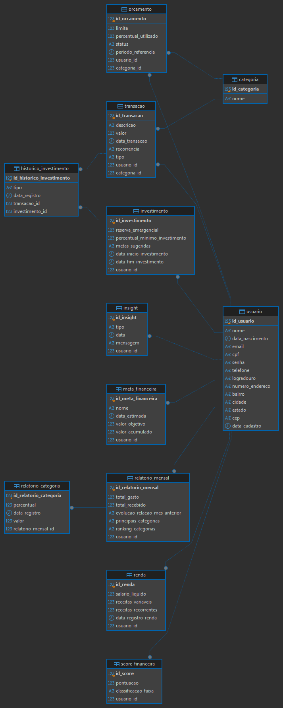

# Banco de Dados - Sistema de Gestão Financeira

Banco de dados relacional em **PostgreSQL** para um sistema de gestão financeira pessoal. O usuário registra receitas e despesas, define orçamentos por categoria, acompanha metas e investimentos e recebe relatórios e insights.

## Diagrama ER

## Conteúdo da pasta

| Arquivo | Descrição |
|---|---|
| `banco_financas.sql` | Script que cria as 12 tabelas e insere dados fictícios de teste |
| `diagrama_er.png` | Diagrama entidade-relacionamento do banco |

## Tabelas

| Grupo | Tabelas |
|---|---|
| Cadastro | `usuario`, `categoria` |
| Movimentação | `transacao`, `renda` |
| Planejamento | `orcamento`, `meta_financeira`, `investimento`, `historico_investimento` |
| Análise | `insight`, `score_financeira`, `relatorio_mensal`, `relatorio_categoria` |

A tabela `usuario` é o centro do modelo: quase todas as outras se ligam a ela por chave estrangeira.

## Como executar

1. Instale o PostgreSQL e o DBeaver.
2. No DBeaver, crie uma conexão com o PostgreSQL e um banco chamado `financas`.
3. Abra um script SQL ligado ao banco `financas` (Ctrl + ]).
4. Abra o arquivo `banco_financas.sql`, copie o conteúdo e cole no script.
5. Execute o script inteiro (Alt + X).
6. Atualize o banco (F5) e confira as tabelas em Esquemas > public > Tabelas.

O script começa apagando as tabelas existentes (`DROP TABLE IF EXISTS`), então pode ser executado mais de uma vez.

## Tecnologias

- PostgreSQL 18
- DBeaver

## Observação

Todos os dados do script são fictícios, criados apenas para teste.
